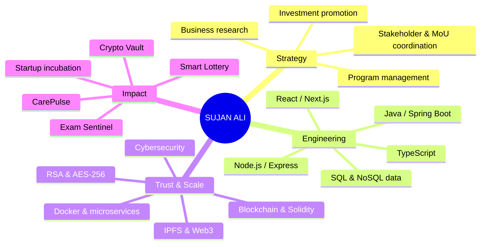
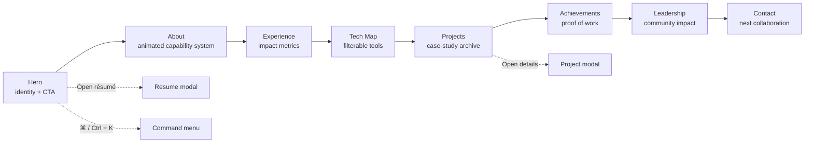
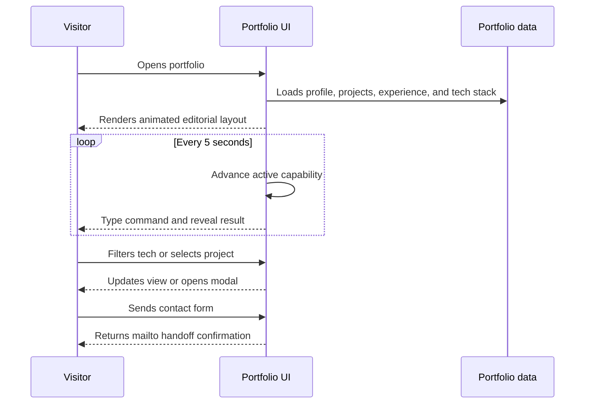

<div align="center">

# SUJAN ALI

### Experimental Digital Portfolio

<a href="https://sujan.talkcare.in">
  
</a>

<p>
  <a href="https://react.dev/"></a>
  <a href="https://www.typescriptlang.org/"></a>
  <a href="https://vite.dev/"></a>
  <a href="https://tailwindcss.com/"></a>
</p>

<p>
  <strong>A neo-brutalist, editorial portfolio for engineering, consulting, cybersecurity, blockchain, and startup leadership.</strong>
</p>

</div>

## What this project is

This is not a static résumé page. It is an interactive portfolio designed to make Sujan Ali's cross-disciplinary work easy to scan, explore, and remember.

The interface combines:

- **Editorial storytelling** — bold typography, paper-grain texture, high-contrast color blocks, and Swiss/neo-brutalist layouts.
- **Technical proof** — project case studies, architecture highlights, technology context, experience metrics, and achievements.
- **Motion as navigation** — running marquees, auto-cycling capability panels, command-line typing, hover transitions, and a precision cursor.
- **Fast exploration** — keyboard-friendly command search, project modals, resume modal, downloadable vCard, and direct contact links.

## Portfolio at a glance



## How the experience flows



## Motion & interaction infographic

The animation system is intentional: it turns dense résumé information into a guided visual scan. Hovering pauses continuous motion so the content remains readable.

| Surface | Motion | Why it exists |
| --- | --- | --- |
| Hero and section banners | Infinite marquee loops | Creates rhythm and separates editorial sections |
| About capability panel | 5-second auto-cycle with pause control | Shows seven professional pillars without a long wall of text |
| About developer console | Command typing + output reveal | Connects each capability to a concrete delivery signal |
| Tech map | Multi-speed technology rows | Makes the stack feel active while keeping filters usable |
| Cursor and cards | Pointer-following cursor, hover lifts, color transitions | Adds tactile feedback without changing the information architecture |
| Modals and navigation | Focused overlays and smooth scroll | Keeps project details and résumé access in the current flow |



## Featured work

| Project | Focus | Stack |
| --- | --- | --- |
| **CarePulse** | Healthcare appointments, notifications, and admin audits | Next.js, TypeScript, Node.js, Appwrite |
| **Personal Data Encryption Service** | AES-256-GCM, PBKDF2, and secure microservices | Spring Boot, React, MongoDB, Docker |
| **Smart Contract Lottery** | Trustless Ethereum raffle with transparent payouts | Solidity, Ganache, Web3.js, React |
| **Anti-Cheating Examination Platform** | Live proctor telemetry and anomaly alerts | React, Spring Boot, PostgreSQL, WebSocket/STOMP |

## Tech stack

```text
Frontend      React · Next.js · TypeScript · Tailwind CSS
Backend       Node.js · Express · Java · Spring Boot · REST APIs
Data          MySQL · PostgreSQL · MongoDB · Appwrite
Trust         RSA · AES-256 · Spring Security · RBAC
Web3          Solidity · Hardhat · Web3.js · Web3.py · IPFS · MetaMask
Delivery      Docker · Vite · Git · Power BI · Microsoft Excel
```

## Run locally

### Prerequisites

- Node.js 18 or newer
- npm (or Bun, using the included `bun.lock`)

### Start the development server

```bash
git clone https://github.com/Sujan3647/New-Portfolio-Sujan-Ali.git
cd New-Portfolio-Sujan-Ali
npm install
npm run dev
```

Open [http://localhost:3000](http://localhost:3000) in your browser.

### Available scripts

| Command | Purpose |
| --- | --- |
| `npm run dev` | Start Vite in development mode on port `3000` |
| `npm run build` | Create the production bundle in `dist/` |
| `npm run preview` | Preview the production build locally |
| `npm run lint` | Run the TypeScript compiler without emitting files |

## Project structure

```text
.
├── public/                 # résumé PDF and public logos
├── src/
│   ├── assets/images/      # portrait and project artwork
│   ├── components/         # portfolio sections and interactive UI
│   ├── data/               # profile, experience, project, and tech content
│   ├── utils/              # portfolio helpers and tests
│   ├── App.tsx             # page composition and modal state
│   └── index.css           # design tokens and keyframe animations
├── index.html              # metadata and font loading
├── package.json            # scripts and dependencies
└── vite.config.ts          # Vite configuration
```

## Design language

| Token | Value | Role |
| --- | --- | --- |
| Ivory | `#F2F0E8` | Paper-like canvas |
| Ink | `#111111` | Type, borders, and structure |
| Electric blue | `#304FFE` | Interactive and technical accents |
| Acid lime | `#D7FF36` | Calls to action and active states |
| Signal orange | `#FF5733` | Emphasis and status moments |

## Connect

- **Portfolio:** [sujan.talkcare.in](https://sujan.talkcare.in)
- **GitHub:** [Sujan3647](https://github.com/Sujan3647)
- **LinkedIn:** [sujan3647](https://linkedin.com/in/sujan3647)
- **Email:** [sujanali9812@gmail.com](mailto:sujanali9812@gmail.com)

---

<div align="center">
  <sub>Built with React, TypeScript, Tailwind CSS, Vite, and a little controlled motion.</sub>
</div>
